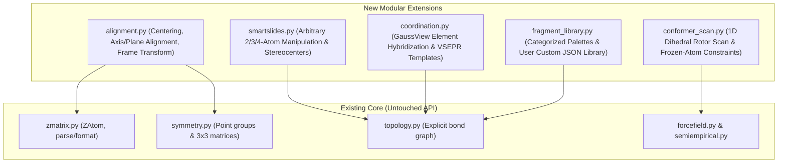

# AgyMolden Modular Architecture & Upgrade Plan

## 1. Root-Cause Diagnosis of the Two Current Issues

Before adding new structure-generation tools, we must resolve two fundamental architectural issues in how AgyMolden handles Cartesian coordinates (`XYZ`) and 3D orientation (`Center` / `Align`):

### Issue A: Why XYZ Files Are Not Read Correctly
1. **Header & Blank-Line Stripping Bug in [`parse_xyz`](file:///home/andres/Desktop/agymoldenshared/agymolden/zmatrix.py#L610-L637)**:
   - `parse_xyz` currently executes `lines = [l.strip() for l in content.splitlines() if l.strip()]` *before* slicing `lines[2:2 + n_atoms]`.
   - In standard `.xyz` files, **line 2 is the comment line, which is very frequently blank**. Stripping blank lines shifts the first atom line into `lines[1]`, causing `lines[2:2 + n_atoms]` to **silently drop the first atom** of the molecule!
   - Furthermore, `parse_xyz` does not normalize atomic numbers (e.g. `6` $\to$ `C`) or case variants (`CL` $\to$ `Cl`), nor does it handle scientific notation with `D`/`d` exponents.
2. **Connectivity & Ring Loss + Coordinate Frame Reset in [`_load_xyz_path`](file:///home/andres/Desktop/agymoldenshared/agymolden/mw_file_io.py#L156-L171)**:
   - If an `.xyz` file lists hydrogens before their parent heavy atoms, or has ring closures (like cyclohexane or benzene), `cartesian_to_zmatrix(symbols, coords)` only builds a forward reference tree (`ref1 < i`). Any ring-closure bond not in the spanning tree is lost because `self.cross_bonds` is reset to `set()`, and any atom whose bonded partner appears *later* in the `.xyz` file is forced to reference an unbonded earlier atom.
   - Then, [`set_molecule_from_zatoms`](file:///home/andres/Desktop/agymoldenshared/agymolden/main_window.py#L216-L264) overwrites `self.coords` with `zmatrix_to_cartesian(zatoms)`, which **destroys the original Cartesian frame** from the `.xyz` file (placing Atom 0 at the origin, Atom 1 on $+Z$, and Atom 2 in $XZ$) and can distort geometries if any 3 reference atoms were nearly collinear.

### Issue B: Why Centering & Axis/Plane Alignment Fail (and Break Symmetry Matrices)
1. **"Center Molecule to Origin" Only Moves the Camera**:
   - In [`mw_editing.py`](file:///home/andres/Desktop/agymoldenshared/agymolden/mw_editing.py#L1424-L1426), `_on_recenter` only calls `self.viewer.auto_center()` (which resets camera pan/zoom) instead of translating `self.coords` so the Center of Mass (COM), centroid, or a selected atom is at $(0, 0, 0)$.
2. **Z-Matrix Reconstruction Erases Global 3D Translations & Rotations**:
   - Because `zmatrix_to_cartesian` always places Atom 0 at $(0,0,0)$, Atom 1 along $+Z$, and Atom 2 in the $XZ$ plane, **internal coordinates alone are invariant to global 3D translation and rotation**.
   - Anytime `set_molecule_from_zatoms` or `update_geometry_live` runs, `self.coords` snaps back to the Z-matrix local frame!
   - **Impact on Symmetry Matrices**: In [`symmetry.py`](file:///home/andres/Desktop/agymoldenshared/agymolden/symmetry.py), the $3\times 3$ transformation matrices ($\hat{C}_n, \hat{\sigma}_v, \hat{\sigma}_h, \hat{S}_n$) are computed in the molecule's current Cartesian axes. If the user cannot center a specific atom/COM at $(0,0,0)$ and align a bond/axis along $X, Y, \text{or } Z$ and a molecular plane into $XY, XZ, \text{or } YZ$—and have that exact 3D orientation **preserved**—the $3\times 3$ symmetry operation matrices will have arbitrary off-diagonal cosines instead of clean canonical matrices (e.g., $\text{diag}(1, -1, 1)$ for $\sigma_{xz}$).

---

## 2. Core Architectural Solution: Rigid-Frame Preservation & Modular Design

To guarantee that **zero existing Z-matrix features or tests break**, we will introduce a clean, backward-compatible Rigid-Frame preservation mechanism and organize all new capabilities into **independent, self-contained modules**.

### How Rigid-Frame Preservation Works Without Breaking Z-Matrix Editing
- We store an optional rigid-body frame transform `(frame_origin, frame_rotation)` or reference coordinate anchor on `MainWindow` (or inside [`alignment.py`](file:///home/andres/Desktop/agymoldenshared/agymolden/alignment.py)).
- When an `.xyz` file is loaded, or when the user explicitly centers/aligns the molecule to an axis or plane:
  1. `self.coords` holds the **exact Cartesian coordinates** (from the `.xyz` file or the aligned frame).
  2. When a Z-matrix internal parameter (bond, angle, dihedral) is tuned via sliders or table edits, `zmatrix_to_cartesian` computes the updated internal geometry and aligns it back onto the active molecular frame (via exact Kabsch/anchor alignment of the unchanged reference atoms) so the molecule **does not jump or lose its user-chosen axis/plane alignment**.
  3. All existing calls to `zmatrix_to_cartesian(zatoms)` in unit tests continue to work identically.

---

## 3. Phased Implementation Plan

### Phase 1: Fix XYZ Import/Export & Explicit Ring/Bond Preservation (Immediate)
- **File**: [`agymolden/zmatrix.py`](file:///home/andres/Desktop/agymoldenshared/agymolden/zmatrix.py) & [`agymolden/mw_file_io.py`](file:///home/andres/Desktop/agymoldenshared/agymolden/mw_file_io.py)
- **Fixes**:
  1. Rewrite `parse_xyz` to preserve line positions (handling blank comment lines on line 2, multi-frame `.xyz` files, atomic numbers `6 -> C`, symbol normalization `CL -> Cl`, and `D` exponents).
  2. In `_load_xyz_path`:
     - Detect full covalent connectivity (`detect_connectivity`) and bond orders (`detect_bond_orders`, aromatic rings) directly from the exact `.xyz` coordinates.
     - Build the Z-matrix while **preserving exact `.xyz` Cartesian coordinates** (`self.coords = coords`), storing any ring-closing bonds in `self.cross_bonds`, and populating `self.viewer.bond_orders`.
     - Provide an option/checkbox or non-destructive reorder if the user wants to canonicalize atom ordering vs. keep exact `.xyz` atom indices.
  3. Add unit tests for `.xyz` files with blank comment lines, rings (`molecule.xyz`), aromatic systems, and arbitrary orientations.

### Phase 2: Precision Centering & Axis/Plane Orientation Module (Immediate)
- **New Module**: `agymolden/alignment.py` + UI controls in **Symmetry** & **Builder** tabs
- **Capabilities**:
  1. **Centering Tools**:
     - **Center at Center of Mass (COM)** $\to (0,0,0)$
     - **Center at Geometric Centroid** $\to (0,0,0)$
     - **Center Selected Atom at Origin** $\to$ translates entire molecule so selected atom $i$ is at $(0,0,0)$.
  2. **Axis Alignment Tools** (select 1 atom for position vector, or 2 atoms for bond/axis vector $\vec{v}_{12}$, or principal axis $\hat{C}_n$):
     - Align along **$+X$, $+Y$, or $+Z$ axis**.
  3. **Plane Alignment Tools** (select 3 atoms defining a plane, or the molecular ring/mirror plane):
     - Align plane into the **$XY$, $XZ$, or $YZ$ plane** (i.e. plane normal along $Z$, $Y$, or $X$), while keeping the primary bond/axis locked along the first coordinate axis!
  4. **Symmetry Matrix Integration**:
     - Automatically refreshes the **Symmetry** tab operations and $3\times 3$ matrices in the newly aligned Cartesian frame so users get textbook-clean transformation matrices for any chosen orientation.

### Phase 3: GaussView "SmartSlides" & Local Stereocenter Inversion
- **New Module**: `agymolden/smartslides.py`
- **Capabilities**:
  1. **Arbitrary 2, 3, or 4 Atom Parameter Manipulation**:
     - Selecting **any 2 atoms** (bonded or non-bonded), **3 atoms**, or **4 atoms** in the 3D viewport activates the interactive tuning sliders for that exact distance, angle, or dihedral—even if those atoms are not linked in the Z-matrix table!
  2. **Group Displacement Modes** (GaussView style):
     - Choose how the modification moves the structure:
       - *Move Group / Substituent* (rotates/translates the connected subgraph on one or both sides)
       - *Move Single Atom Only*
       - *Keep Atom 1 Fixed vs. Symmetric (50/50)*
  3. **Invert Chiral Center ($R/S$ Local Inversion)**:
     - Select a tetrahedral/pyramidal stereocenter (or center + 2 substituents) and click **Invert Center** to swap the two substituent subgraphs in 3D, interconverting enantiomers/diastereomers locally without flipping the rest of the molecule.

### Phase 4: GaussView Element Coordination & Hybridization Templates
- **New Module**: `agymolden/coordination.py` + enhanced [`periodic_table.py`](file:///home/andres/Desktop/agymoldenshared/agymolden/periodic_table.py)
- **Capabilities**:
  1. Expand element valences and covalent radii across the entire periodic table (including transition metals, lanthanides, and hypervalent main-group states).
  2. Add a **Coordination / Hybridization selector** at the bottom of the Periodic Table dialog:
     - *Naked Atom (0)*, *Linear (2)*, *Bent (2)*, *Trigonal Planar (3)*, *Pyramidal (3)*, *T-Shaped (3)*, *Tetrahedral (4)*, *Square Planar (4)*, *Seesaw (4)*, *Trigonal Bipyramidal (5)*, *Square Pyramidal (5)*, *Octahedral (6)*.
  3. Placing or double-clicking an atom with a chosen coordination geometry spawns the directional valence vectors (populated with H or open ligand sites).

### Phase 5: Categorized Fragment Library & Custom User Fragments
- **New Module**: `agymolden/fragment_library.py`
- **Capabilities**:
  1. Organize built-in fragments into categories (**Rings**, **Functional Groups**, **Solvents**, **Ligands & Metal Complexes**, **Amino Acids / Bases**) while keeping the `FRAGMENTS` dict in [`fragments.py`](file:///home/andres/Desktop/agymoldenshared/agymolden/fragments.py) 100% backward-compatible.
  2. **"Save Selection to Custom Library"**: Save any selected subgraph or molecule (with its explicit bonds, bond orders, and anchor atom) to `~/.config/AgyMolden/custom_fragments.json` for permanent reuse across sessions.

### Phase 6: Frozen-Atom Constraints & 1D Dihedral Conformer Scanner
- **New Module**: `agymolden/conformer_scan.py` + constraint support in [`forcefield.py`](file:///home/andres/Desktop/agymoldenshared/agymolden/forcefield.py) & [`semiempirical.py`](file:///home/andres/Desktop/agymoldenshared/agymolden/semiempirical.py)
- **Capabilities**:
  1. **Freeze / Pin Selected Atoms**: Lock selected atoms in space during UFF/MMFF94s and GFN0-xTB optimizations (zeroing their gradient components).
  2. **1D Dihedral Rotor Scan**: Select 4 atoms defining a rotatable bond, specify step size (e.g., $15^\circ \times 24$ steps), compute the relaxed or rigid energy profile, and click any point on the curve to snap the 3D molecule to that conformer.

---

## 4. Verification & Non-Regression Guarantee
- After each phase, the entire existing test suite (`pytest tests/test_zmatrix.py tests/test_aromatic.py tests/test_modules.py`) will be run to verify zero regressions.
- Every new module will have its own dedicated unit test file (`tests/test_xyz_and_alignment.py`, `tests/test_smartslides.py`, `tests/test_coordination.py`, etc.).
